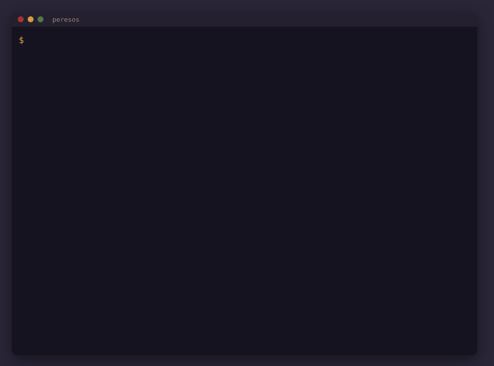
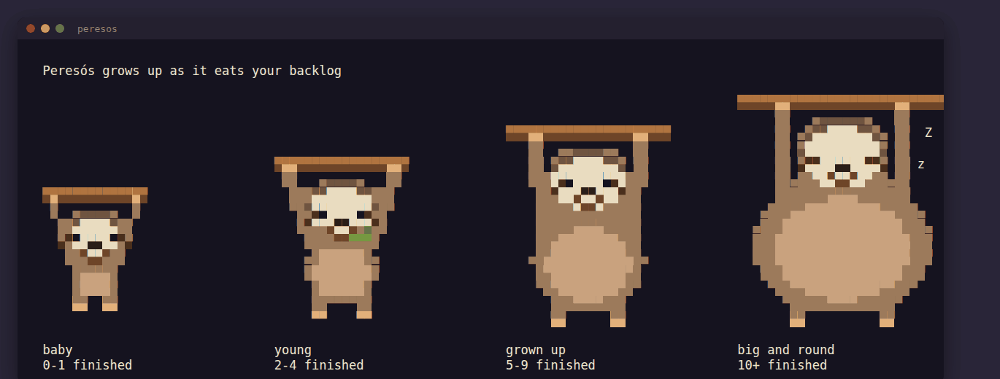
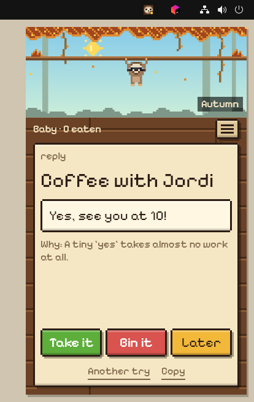
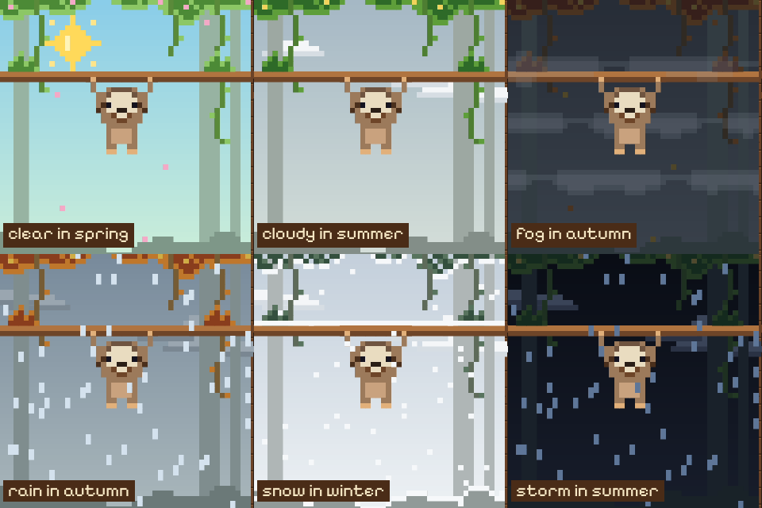
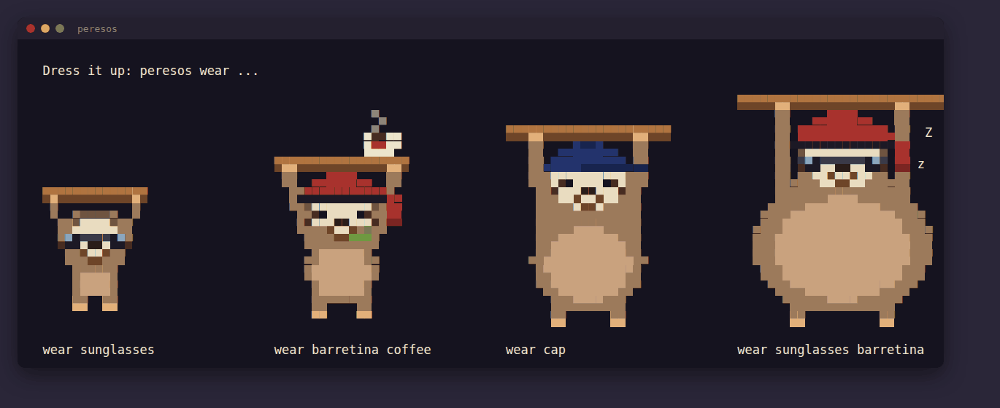
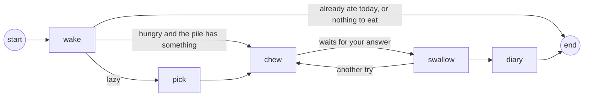

# Peresós

A sloth that lives in your terminal, or in a pixel-art window on your desktop, and eats one item of your backlog a day. You only say yes or no.



*Peresós* is Catalan for sloth, and for lazy.

## What it does

You feed it the things you keep putting off: the message you haven't answered, the decision you
keep postponing, the note you never sorted. Once a day you wake it. It takes the oldest item and
**Gemma 4, running on your own machine**, prepares the finished version:

- a **reply**, written as you, in the language of the message,
- a **decision**, with one or two sentences on why,
- a **note**, cleaned up,
- or for a **task**, the first step, which takes five minutes at most.

Then it waits for you:

- **`y`**: take it. The finished version is saved in `~/.peresos/done`, and the item leaves the pile.
- **`n`**: bin it. Deciding not to do something also finishes it.
- **`l`**: later. It goes back to the bottom of the pile.
- **`a`**: another try. Gemma makes a different version and knows which ones you didn't want.
- **Enter**: decide another day. It keeps the item in its mouth. Close the terminal, come back
  tomorrow, and it asks again without calling the model a second time.

Feeling lazy? **`peresos --lazy`** (or **Something easy** in the window) lets the sloth do what it
does best. Gemma looks at the whole pile, picks the easiest item and tells you why ("A yes is one
word."), then prepares the laziest version that still gets it off the pile: a reply of one or two
lines, the choice with no follow-up, a two-minute first step. Sometimes the laziest answer is honest:
*Don't do it*, with one sentence why, and you bin it. The next lazy wake picks a different item, so
one you put off with "later" doesn't come back every time. The normal wake still eats the oldest
item, so the hard ones get their turn.

It eats one item a day at most. Skip a few days and it simply sleeps, then tells you how long. It
never nags. It writes a line in its diary after every meal, and grows up as the pile shrinks: a baby
that kicks its little legs, a young sloth chewing a leaf, a grown one yawning, and after ten items,
a big round sloth asleep on its branch. When you have finished the whole pile, it says so, and
sleeps on top of its branch, full, until you feed it again.



## Install

One line installs Peresós with its own Java, puts the `peresos` command on your PATH, adds it to
the menu of apps (it opens its window), and runs `peresos doctor`:

```bash
# Linux and macOS (Apple silicon)
curl -fsSL https://raw.githubusercontent.com/deeptelar/peresos/main/install.sh | sh
```

```powershell
# Windows, in PowerShell
irm https://raw.githubusercontent.com/deeptelar/peresos/main/install.ps1 | iex
```

On Debian and Ubuntu it installs the `.deb` of the [latest release](https://github.com/deeptelar/peresos/releases/latest)
with apt, so `sudo apt remove peresos` removes it; elsewhere it installs in your home, without sudo.
You also need [Ollama](https://ollama.com/download). Then:

```bash
peresos doctor          # checks Ollama, Gemma, its folder, the desktop, and the command
peresos doctor --fix    # pulls Gemma 4 (gemma4:12b, about 8 GB) if it is missing
```

### Build it yourself

With a JDK 17 or newer:

```bash
git clone https://github.com/deeptelar/peresos.git
cd peresos
./gradlew installDist
alias peresos="$PWD/build/install/peresos/bin/peresos"
```

`./gradlew appImage` then `packaging/linux.sh` builds the `.deb` and the `.tar.gz` of a release;
the [Package workflow](.github/workflows/package.yml) builds them on Linux, macOS and Windows.

## Run it

```bash
peresos about "I work from home on Tuesdays and Thursdays"   # once: facts it uses when it prepares things
peresos feed "the message, decision or note you keep avoiding"
pbpaste | peresos feed                                      # or pipe it in (xclip -o on Linux)
peresos                                                      # wake it: it eats the oldest item
peresos --lazy                                               # or the easiest one, done the laziest way
peresos pile                                                 # what is still on the pile
peresos diary                                                # what it wrote about its meals
peresos wear sunglasses coffee                               # dress it up (peresos wear lists it all)
peresos window                                               # its home in your tray
peresos place "Girona"                                       # optional: that town's weather in the window
```

The pile is a plain text file, `~/.peresos/pile.md`, with items separated by a line with `---`.
Edit it by hand whenever you like. `PERESOS_MODEL` picks another Ollama model and `PERESOS_HOME`
another folder. `peresos --hungry` lets it eat more than once a day, for a demo.

**Nothing leaves your computer.** Your messages, your facts and its diary stay in `~/.peresos`, and
the model runs in your local Ollama. The one exception is opt-in: if you give the window a town for
its weather, that town goes to [Open-Meteo](https://open-meteo.com), and nothing else. With thinking on, a meal takes 10 to 60 seconds on an 8 GB GPU (an RTX 3070):
slow, but you were going to wait a day anyway.

### When something goes wrong

`peresos doctor` says what is missing and how to get it. What fails, also in the window, goes with
its details to `~/.peresos/logs/peresos.log`, and stays there. `peresos doctor --report` writes a
file with the checks, your system and the last failures, but no word of your pile, your diary or
what Peresós knows about you, and offers to open a new issue with it filled in. Nothing is sent
until you submit the issue yourself.

## A home on your desktop

`peresos window` puts the sloth in your tray, like JetBrains Toolbox: a small pixel face in the top
bar, and under it a small window that fits the screen. At the top is its habitat, a pixel-art jungle
where it hangs from its branch and plays its animations. Below it is what the sloth is doing, with
the buttons for it: wake it, then take what Gemma prepared, bin it or leave it for later (or ask
for another try, or copy it). The menu (☰) has the rest of what the terminal does: feed the pile,
read the diary, dress it up, tell it about you, **About** (which links back to this page), and quit.



Click the face to open or hide the window, or click anywhere else to hide it. It stays out of the
dock, and the face shows what the sloth is doing: a green badge while it chews, a yellow one when a
bite waits for your answer, a red one when Ollama is gone. Gemma takes a minute, so wake it, hide it,
and the desktop tells you when the bite is ready. Quit from the window or the face's menu (right
click). Running `peresos window` again just opens the window. Without a tray, it's an ordinary
window, and closing it quits.

Click the sloth itself and it answers, in a speech bubble over its head. Pat its head and it
closes its eyes; tickle its belly and it laughs and kicks; poke it anywhere else and it opens its
eyes and talks about what it's doing ("Mmf. Mouth full." while it chews). Keep poking and it
pretends to sleep. The pointer turns into a hand over it. All of this happens in the window, with
no Gemma call.

The window and the terminal share `~/.peresos`, so they show the same sloth: feed it in the
terminal and the window shows the new item a moment later. Only one of them can wake it at a time.

The leaves follow the season, and the sky follows the weather, by day and by night: sun, clouds,
fog, rain, snow on the branch, or a storm with lightning. Without a town it shows the season only;
`peresos place "your town"` (or **You** in the menu) adds the weather. To try them all:
`peresos window --season=winter --weather=snow`.



## Dress it up

`peresos wear` puts things on it: `sunglasses`, a `cap`, a `barretina` (the red Catalan cap) and a
`coffee` on the branch. One item per place, so a new hat replaces the old one, and
`peresos wear nothing` takes it all off. They fit every phase, and stay on while it sleeps.



### Add an item

Every item is a short function in [`Wardrobe.kt`](src/main/kotlin/dev/deeptelar/peresos/Wardrobe.kt)
that draws a few pixels relative to the head, the eyes or the branch, so one drawing fits every
size. To add a scarf, a flower or a tiny laptop: add an entry to `Item`, a branch to `wear` and the
function that draws it. `./gradlew test` checks it in every phase and pose, and
`./gradlew installDist` then `peresos wear yours` shows it. Pull requests welcome, with a
screenshot.

## How it is built

Peresós is a workflow of [Telar](https://github.com/deeptelar/telar), an open-source Kotlin library
for AI agents and workflows as small typed graphs. Telar is my own library; this app is new, and
uses it from Maven Central like any other.



- **The sloth is one `@Serializable` data class**, [`Sloth`](src/main/kotlin/dev/deeptelar/peresos/Sloth.kt):
  when it last ate, what it is chewing, its meals and its diary.
- **Every step is saved** in a checkpoint file, so its memory from one day to the next is the
  checkpoint of the last run.
- **It waits for you** with an interrupt before `swallow`. The run stops, the process ends, and the
  next `peresos` resumes it from the checkpoint with your answer.
- **Gemma answers with a typed value**: `chew` asks for a `Bite` (kind, title, finished text) with
  `ask<Bite>`, which gives the model the JSON schema of the class and asks again when an answer
  does not fit. A lazy wake's `pick` asks for a `Pick` (the number of the easiest item and why) the
  same way, and a number that is not on the list counts as a failed try.
- **The pile changes exactly once**: `swallow` edits the pile and writes the file inside an
  `effect`, which Telar saves with the step, so a crash halfway never eats an item twice.
- **Thinking where it helps**: `chew` lets Gemma think; the diary line uses the same model with
  `reasoning_effort: "none"`. In my test, a three-word answer took 37 seconds with thinking and 4
  without.
- **The portrait is drawn, not stored**: [`Portrait`](src/main/kotlin/dev/deeptelar/peresos/Portrait.kt)
  draws the sloth from ovals sized for its phase, two pixels per character in 24-bit color, and
  plays its animation only when the output is a terminal.
- **The window draws a snapshot**: [`SlothModel`](src/main/kotlin/dev/deeptelar/peresos/SlothModel.kt)
  runs the same graph in a Telar `GraphSession`, whose `StateFlow` of snapshots the Compose window
  draws: running, waiting for your answer, done or stopped. Its controls are a small pixel-art kit
  in [`PixelUi.kt`](src/main/kotlin/dev/deeptelar/peresos/PixelUi.kt), and the habitat is drawn
  pixel by pixel in [`Habitat.kt`](src/main/kotlin/dev/deeptelar/peresos/Habitat.kt).
- **Tested without a model**: [`SlothTest`](src/test/kotlin/dev/deeptelar/peresos/SlothTest.kt) runs
  the whole graph with a scripted model, and [`WindowTest`](src/test/kotlin/dev/deeptelar/peresos/WindowTest.kt)
  clicks through the window and draws it in every weather, `./gradlew test`.
- **A long walk**: [`SoakTest`](src/test/kotlin/dev/deeptelar/peresos/SoakTest.kt) clicks the
  window's buttons in random order for months of simulated days, while a terminal feeds, wakes and
  holds the lock, the pile is edited by hand and Ollama stops halfway, and checks the pile, the
  checkpoint, the lock and the screen after every action. `./gradlew soak -Psteps=5000` runs it
  long, `-Pseed=7` repeats a walk, and `-Pgemma` uses the real model.

## Contributing

Help is welcome, also without code: try the installer on your system and say what you saw. The
issues labeled [testing](https://github.com/deeptelar/peresos/issues?q=is%3Aissue+is%3Aopen+label%3Atesting)
say what to look at. [CONTRIBUTING.md](CONTRIBUTING.md) has how to build, test and package it.

## Credits

- [Gemma 4](https://ai.google.dev/gemma) by Google, the open-weight model that does the work.
- [Ollama](https://ollama.com), which runs it locally.
- [Telar](https://github.com/deeptelar/telar), the workflow library underneath.
- [Compose Multiplatform](https://www.jetbrains.com/compose-multiplatform/), which draws the window.
- [Pixelify Sans](https://github.com/eifetx/Pixelify-Sans), the pixel font of the window, under the
  SIL Open Font License.
- [Open-Meteo](https://open-meteo.com), the weather, free and without a key.

Built for the [DEV Hacktoberfest Open-Source AI Challenge, week 3: Slow and Steady](https://dev.to/challenges/hacktoberfest-week3-2026-10-19).

Apache License 2.0.
