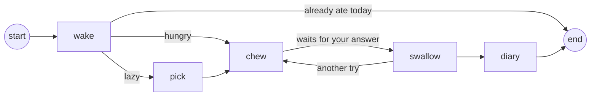

# Peresós

A sloth that eats one item of your backlog a day. You feed it what you keep putting off, and
**Gemma 4, on your own machine**, prepares the finished version. You only say yes or no.


*Peresós* is Catalan for sloth, and for lazy.

How and why I built it: [the post on DEV](https://dev.to/cuento3yllevo2/peresos-a-sloth-that-eats-one-item-of-my-backlog-a-day-with-gemma-4-on-my-own-gpu-j6a).

## Install

```bash
# Linux and macOS (Apple silicon)
curl -fsSL https://raw.githubusercontent.com/deeptelar/peresos/main/install.sh | sh
```

```powershell
# Windows, in PowerShell
irm https://raw.githubusercontent.com/deeptelar/peresos/main/install.ps1 | iex
```

It brings its own Java, the `peresos` command, a menu entry and **Feed to Peresós** in the
right-click menu of photos and PDFs. You also need [Ollama](https://ollama.com/download):

```bash
peresos doctor --fix    # checks everything and pulls Gemma 4 (gemma4:12b, about 8 GB)
```

`peresos update` and `peresos uninstall` do what they say. To build it yourself, see
[CONTRIBUTING.md](CONTRIBUTING.md).

## Use it

```bash
peresos about "I work from home on Tuesdays and Thursdays"   # facts it uses in its answers
peresos feed "Jordi: coffee on Friday at 10, still on?"      # a message, decision, note or task
peresos feed bill.jpg                                        # or a photo, a PDF or a text file
                                                             # (photos and PDFs: right-click, Feed to Peresós)
peresos                                                      # wake it: it eats the oldest item
peresos --lazy                                               # or the easiest one, the laziest way
peresos window                                               # its home in the tray
```

Gemma prepares the finished version: a reply written as you, a decision with why, a cleaned-up
note, or the first five-minute step of a task. Then you answer:

| Key | |
|---|---|
| `y` | Take it. It's saved in `~/.peresos/done` and leaves the pile. |
| `n` | Bin it. Not doing it also finishes it. |
| `l` | Later. Back to the bottom of the pile. |
| `a` | Another try. |
| Enter | Decide another day. It waits, without asking Gemma again. |

It eats one item a day at most and never nags. It writes a diary line after every meal and grows
rounder as the pile shrinks.


```bash
peresos pile              # list the pile
peresos pile edit 3       # edit item 3 in your editor
peresos pile remove 3     # take it off
```

In the window, the pencil next to an item does the same. The pile is a plain text file,
`~/.peresos/pile.md`, with items separated by `---`.

**Without Ollama:** `peresos gemma off` brings each item as you wrote it, for yes, bin it or later.
`peresos gemma on` brings Gemma back.

## The window

`peresos window` puts the sloth in your tray, and the terminal can close. The window does
everything the terminal does. Click the sloth and it answers. The sky follows the season and, with
`peresos place "Girona"`, the weather.

The arrow in the title bar folds the window up to the sloth alone. Folded, it says when a bite waits.

```bash
peresos desktop on      # an icon on the desktop
peresos autostart on    # start at login
```


## Dress it up

```bash
peresos wear sunglasses coffee    # also cap, barretina; nothing takes it all off
```


Each item is a small function in [`Wardrobe.kt`](src/main/kotlin/dev/deeptelar/peresos/Wardrobe.kt).
Adding one is a good first pull request.

## Privacy

Everything stays in `~/.peresos`, and Gemma runs in your local Ollama. Only two things go out, and
only when you ask: your town to [Open-Meteo](https://open-meteo.com) for the weather, and
`peresos update` to GitHub.

If something fails, `peresos doctor` says what's missing. `peresos doctor --report` writes a report
without your pile, your diary or your facts, and offers to open an issue with it.

## How it is built

Peresós is a graph of [Telar](https://github.com/deeptelar/telar), my open-source Kotlin library
for AI workflows, used from Maven Central.



- The sloth is one `@Serializable` data class, saved after every step. Its memory is the last checkpoint.
- It waits for you by stopping before `swallow`. The next `peresos` resumes with your answer.
- Gemma answers with a typed `Bite` through `ask<Bite>`, not text to parse.
- `swallow` changes the pile inside an `effect`, so a crash never eats an item twice.
- The window runs the same graph in a `GraphSession`, drawn by Compose.
- The tests run the whole graph with a scripted model, so they need no GPU.

## Contributing

Trying the installer on your system helps too: see the issues labeled
[testing](https://github.com/deeptelar/peresos/issues?q=is%3Aissue+is%3Aopen+label%3Atesting).
[CONTRIBUTING.md](CONTRIBUTING.md) has how to build and test.

## Credits

[Gemma 4](https://ai.google.dev/gemma) by Google, [Ollama](https://ollama.com),
[Telar](https://github.com/deeptelar/telar),
[Compose Multiplatform](https://www.jetbrains.com/compose-multiplatform/),
[Pixelify Sans](https://github.com/eifetx/Pixelify-Sans) (SIL Open Font License) and
[Open-Meteo](https://open-meteo.com).

Built for the [DEV Hacktoberfest Open-Source AI Challenge, week 3: Slow and Steady](https://dev.to/challenges/hacktoberfest-week3-2026-10-19).
Apache License 2.0.
